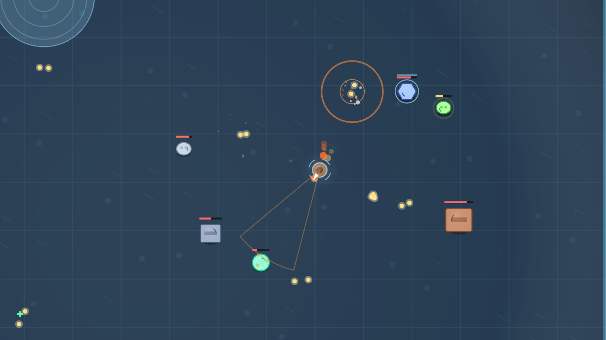
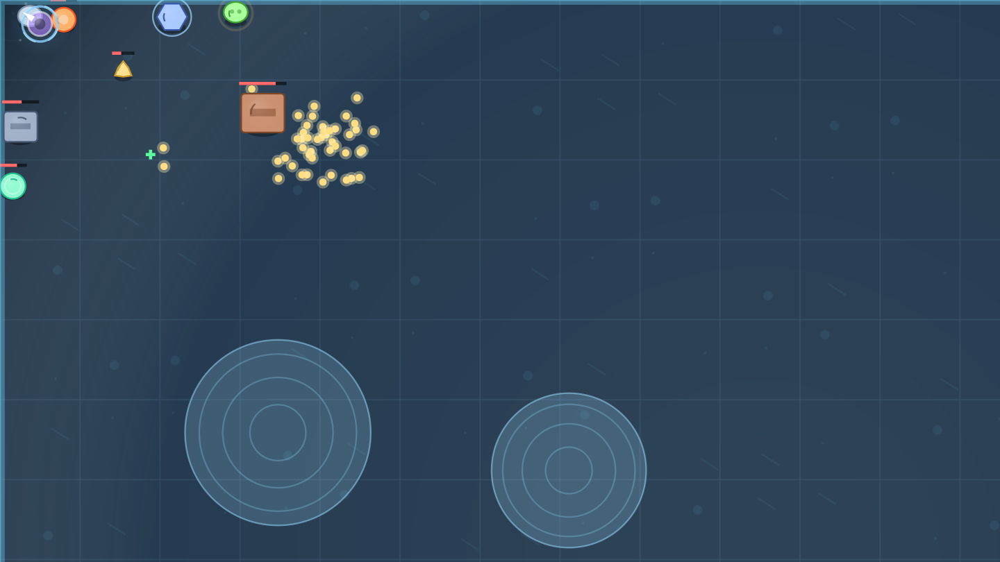

# SHARDFALL

A complete, playable **action survival roguelite** for the browser. No build step, no
dependencies, no assets — just open `index.html`.



Fight endless waves across four biomes, build a run out of 14 weapons (14 evolutions),
13 armour sets, 15 enemy types, elite modifiers, 5 characters and 4 multi-phase bosses.
Everything is data-driven and fully implemented: progression, economy, rewards, events,
permanent unlocks, achievements and local saves.

```
index.html
css/style.css
js/util.js      math + helpers
js/data.js      all content: weapons, evolutions, armour, passives, relics, enemies,
                bosses, biomes, characters, achievements, events
js/audio.js     procedural WebAudio SFX + ambient loop (no audio files)
js/save.js      localStorage progression, unlocks, achievements, settings
js/world.js     simulation: combat, statuses, AI, bosses, waves, scaling, economy
js/render.js    canvas renderer: arena, entities, VFX, post-processing
js/ui.js        DOM interface: menus, HUD, rewards, market, events, codex
js/main.js      state machine, input (desktop + touch), game loop
tests/sim.js    headless simulation + balance + content coverage suite (no deps)
tests/browser.js DOM integration suite (needs jsdom)
```

## Play

Open `index.html` in any modern browser, or serve the folder:

```bash
python3 -m http.server 8000    # then visit http://localhost:8000
```

### Desktop controls

| Action | Input |
| --- | --- |
| Move | `WASD` / arrow keys |
| Aim | Mouse |
| Fire | Hold left mouse (or `F` to toggle) |
| Dash (i-frames) | `Space` / right mouse |
| Character ability | `E` |
| Use item | `1` – `6` |
| Pause | `Esc` / `P` |
| Fullscreen layout | responsive — canvas scales with the window |

### Mobile / touch controls

Left thumbstick moves, `FIRE` auto-aims at the nearest enemy, dash and ability buttons
sit under the right thumb, consumables above them. Landscape is recommended.



## Systems

**Combat** — weapon-driven attacks with per-weapon hit detection (melee arcs, spread
pellets with range falloff, piercing beams, chain lightning, cone flame ticks,
explosive splash, boomerang blades, toxic clouds). Crits, knockback, lifesteal,
per-element resistances and weaknesses, and five status effects:
burn, chill, poison stacks, shock chains and shadow marks.

**Progression per run** — every cleared level offers three reward cards (weapon, armour,
passive, weapon upgrade, relic, consumable, gold, heal, evolution). Gold from kills,
elites, bosses and clears is spent in a market between levels. Equip any owned weapon or
armour at any time between levels, so nothing is forced.

**Weapon evolution** — weapons cap at level 5. A max-level weapon plus two stacks of its
matching elemental attunement unlocks an evolution with a genuinely different attack
(homing fire crescents, echoing phantom slashes, explosive pellet spreads, all-piercing
implosions, orbiting storms, cluster shells, plague clouds, freezing shatters and more).

**Enemies** — 15 types with distinct AI: chasers, sprinters, ranged spitters, armoured
bulwarks with shields, bombers that arm and detonate, healers, summoners, slam brutes,
blink assassins, flyers, regenerating wardens, cursers and splitters. Elites roll
modifiers (armoured, regenerating, volatile, enraged, poisonous, swift, shielded).
Later levels combine types rather than only inflating health bars.

**Bosses** — four bosses on a five-level cadence, each with multiple phases, telegraphed
attack sets and exclusive drops: The Butcher (charges, shockwaves, cleaver sweeps),
Hive Matron (broods, acid pools, spit fans), Frost Colossus (ice beams, freeze zones,
shard rings) and the Void Sovereign (teleport slams, bullet rings, void pulls, summons).
Bosses repeat at higher tiers with more health, damage and modifiers.

**Difficulty** — health, damage, speed, spawn count and elite chance scale with separate
curves, so time-to-kill grows slowly while enemy threat grows more slowly still. Three
difficulties plus five optional challenge modifiers. Anti-stall rules (enrage at 75s,
overwhelm at 110s) guarantee every level terminates, and the player's power curve
(weapon levels, passives, relics, evolutions, armour affixes) keeps pace with the curve.

**Meta progression** — shards earned at the end of a run buy permanent unlocks (weapons,
armour) and five capped permanent upgrades. All permanent bonuses are small by design:
skill still dominates.

**Also** — 7 between-level events with real trade-offs, 14 achievements, codex with
weapons/armour/relics/enemies/bosses/upgrades, full statistics, save persistence and
settings (volume, music, shake, damage numbers, aim assist, effect density).

## Tests

```bash
node tests/sim.js standard     # content integrity
node tests/sim.js systems      # rewards, shop, equipment, evolution, statuses
node tests/sim.js weapons      # every weapon and evolution deals damage
node tests/sim.js armours      # every armour set changes stats
node tests/sim.js enemies      # every enemy AI acts and does not crash
node tests/sim.js consumables  # every consumable has an effect
node tests/sim.js bosses       # every boss runs its phases
node tests/sim.js runs         # full autopilot runs per character
node tests/sim.js deep         # immortal buffed run, per-level clear times to level 60
node tests/sim.js all
```

`tests/browser.js` boots the real page in jsdom and drives the actual UI: menus,
character select, HUD, reward picks, market, events, evolution, death/retry, codex and
save persistence. It needs the dev-only packages:

```bash
npm i -D jsdom canvas
node tests/browser.js
```

## Notes

- No external assets: every visual is drawn on canvas, every sound is synthesised.
- Saves live in `localStorage` under `shardfall_save_v2`; "Reset all progress" is in Settings.
- The floor layer is pre-rendered per biome and blitted, keeping the frame budget low;
  particles are pooled/capped and can be dialled down in Settings.
